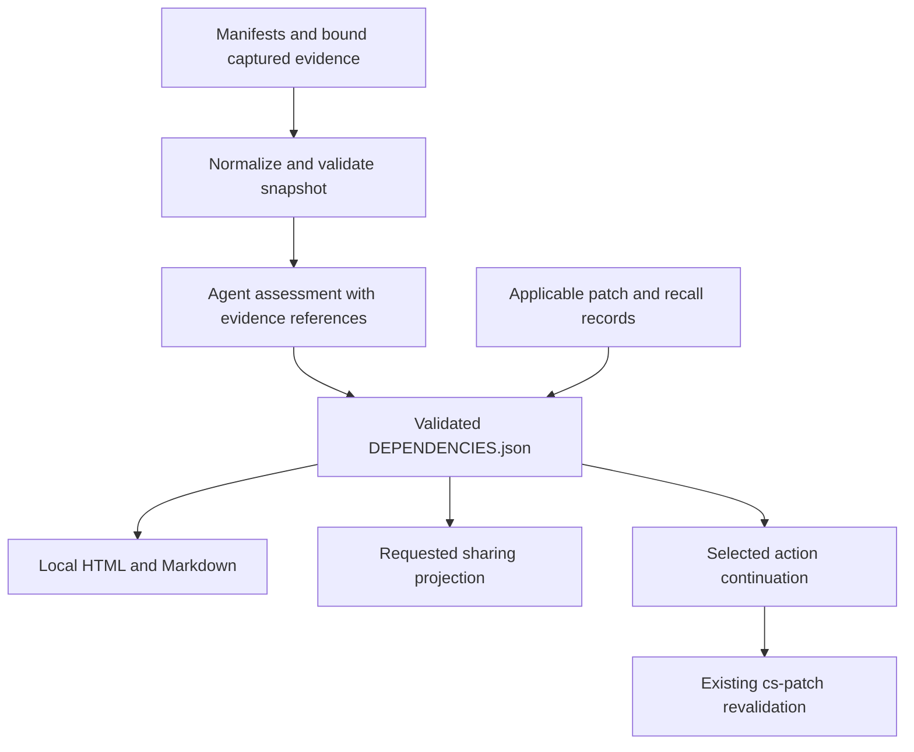
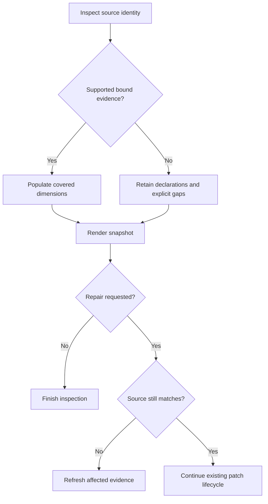

# Local Dependency Visibility - Plan

## Goal Capsule

- Objective: A technical owner can identify and explain the next useful dependency upgrade, then initiate the existing repair workflow without granting an outside team repository access.
- Means: Extend the existing plugin with a dependency inspection skill, shared evidence records, and local reports (KTD1–KTD4).
- Authority: User scope and repository execution constraints govern; Product Requirements govern behavior, technical decisions govern mechanisms, and unit details override neither.
- Execution profile: One PR with five dependency-ordered units. This document authorizes planning only; implementation and publication follow the user's subsequent instruction.
- Stop conditions: Unsupported acquisition or absent execution controls yield a partial report. Missing evidence never becomes a passing check. Product-scope changes require a new decision.
- Ownership: The implementing agent completes local code, tests, and review. The maintainer controls release; target repository owners control repairs and sharing.

---

## Product Contract

### Summary

Add a local dependency-inspection entry point to Compound Security. Turn available npm/pnpm evidence into explained upgrade actions, dependency paths, and a report that can be deliberately shared. Reuse the existing patch and learning lifecycle.

### Problem Frame

Founders request remediation, but technical owners control access and hesitate to hand it over. They will run inspectable tools themselves. Vulnerability counts overwhelm recipients, while the service team spends substantial effort chasing access. The repository already defines repair, verification, and compounding workflows; its dependency evidence lacks a consistent human-facing view.

### Actors

- A1. Technical owner runs the plugin and chooses whether to repair or share.
- A2. Host agent gathers permitted evidence, explains priorities, and invokes existing workflows within the request.
- A3. Founder or consultant reads a deliberately exported summary without receiving repository access.

### Requirements

**Entry and evidence**

- R1. Deliver this capability as an inspectable skill within the existing plugin, with npm/pnpm as the initial ecosystems and inspection leaving target source unchanged.
- R2. Inventory declared dependencies and available resolved instances, preserving workspace, version, direct/transitive paths, and lockfile-versus-installed provenance.
- R3. Show outdated status and advisory applicability as separate observations, with per-category coverage, capture date, and explicit unknowns when evidence is absent or unsupported.
- R4. Bind evidence to the analyzed source and workspace scope; unbound or mismatched imports must not support a current confident upgrade recommendation.

**Decisions and explanation**

- R5. Present ordered upgrade actions with reasons, supporting evidence, uncertainty, affected instances, and prerequisites; deduplicate advisory identities separately from package occurrences and do not sum overlapping action benefits.
- R6. Explain dependency ancestry and observed application usage separately from historical intent; inferred intent is labeled and absent evidence stays unknown.
- R7. Show dependency paths and action detail in a local report, with a concise recommendation summary and access to the underlying inventory.

**Trust and continuation**

- R8. Report generation performs no upload or repair; optional online evidence acquisition names its destination and disclosed data and respects existing authorization and execution controls.
- R9. Produce a deliberately requested sharing projection that excludes private evidence by default and remains a local file until the user shares it.
- R10. A selected action carries source identity and scope into the existing patch workflow, which revalidates them before editing; a report is never an authorization source.
- R11. Display applicable patch verification and lessons used from existing records, retaining independent security, compatibility, and deployment status and marking stale results historical.
- R12. Human reports and agent-readable records express the same evidence and gaps; package metadata and retrieved text cannot introduce executable instructions.

### Key Decisions

- **Local open-source plugin** (session-settled: user-directed — chosen over handing external operators access: technical owners accept locally run tools). Governs R1, R8, R10.
- **Bounded ecosystem and sharing scope** (session-settled: user-approved — npm/pnpm and deliberate local sharing chosen over a hosted public scan and competitive scorecard). Governs R1, R3, R9.
- **Reuse file-based learning** (session-settled: user-approved — Markdown lessons and structured records chosen over adding a vector database). Governs R11, R12.

### Key Flows

- F1. A1 requests inspection → A2 recalls lessons, reads manifests, acquires permitted evidence, validates a snapshot, and generates a local report → A1 sees a next action or an exact information gap. Covers R1–R8, R12.
- F2. A1 requests repair of an action → A2 rechecks source and hands off to `cs-patch` → subsequent inspection projects applicable patch/recall results. Covers R4, R10, R11.
- F3. A1 requests a shareable summary → A2 creates a restricted local export → A1 reviews and shares it outside the plugin. Covers R8, R9, R12.

### Acceptance Examples

- AE1. Two parent paths reach the same advisory: the report shows both paths and affected instances, one advisory identity, and distinct candidate actions without adding overlapping reductions. Covers R2, R5, R7.
- AE2. Registry access is unavailable: the report retains local inventory and says outdated/advisory checks are unavailable, rather than displaying zero issues or a clean bill of health. Covers R3, R8.
- AE3. A saved action belongs to an older lockfile: patch handoff requires refreshed evidence and does not silently apply the old recommendation. Covers R4, R10.
- AE4. A patch is locally verified but not deployed: the report retains that distinction and names the applicable lesson without inventing production closure. Covers R11.
- AE5. A manifest contains HTML and a private registry URL: the local view renders inert text; the sharing projection excludes the URL and masks unverified/private names. Covers R9, R12.

### Success Criteria

In a behavioral exercise, a technical owner can identify the proposed first action, explain its dependency path and rationale, locate its evidence gaps, and initiate a scoped continuation without interpreting raw JSON. This is a usability acceptance check, not a claim that adoption or urgency has improved.

### Scope Boundaries

This work adds inspection and reporting, not a replacement patch engine. Existing `execution.md`, `patching.md`, `knowledge.md`, and closure rules remain authoritative.

#### Deferred to Follow-Up Work

Hosted repository intake, public scorecards and viral mechanics, infrastructure ecosystems beyond npm/pnpm, automatic deployment, continuous monitoring, vector retrieval, and cross-customer learning. Wider package-manager version support follows proven adapter fixtures.

Automatic installs, toolchain downloads, HTML repair controls, telemetry, and direct advisory-service clients are not built: they are unnecessary for the local report and would change its trust boundary.

---

## Planning Contract

### Key Technical Decisions

- KTD1. Add `cs-dependencies` as a thin wrapper selecting a new core `dependencies` mode. Follow `skills/cs-patch/SKILL.md` and `references/commands.md`; update discovery routes rather than building another orchestrator. Governs R1, R10.
- KTD2. Use a versioned `DEPENDENCIES.json` snapshot as the shared report input. Bundled CommonJS scripts normalize explicit files and render views; they do not launch package managers, load target configuration as code, install packages, or make network requests. Host collection remains subject to `references/execution.md`. Governs R2–R4, R8, R12.
- KTD3. Start with documented npm 11 and pnpm 10.23+ within major 10 JSON adapters, with fixtures required before claiming support. These are bounded adapter families, not a latest-version claim. Other versions get manifest-level coverage plus an unsupported-adapter gap; never change a user's toolchain. Use lockfile-only list output where available, avoiding a custom pnpm lockfile parser in this release. Governs R2, R3.
- KTD4. Emit self-contained `DEPENDENCIES.html` and `DEPENDENCIES.md` from the same validated record. HTML uses bundled CSS/JavaScript only, with no server, CDN, fetch, telemetry, or executable action buttons. Show an expandable dependency-path view and matching accessible text listing; focus initially on the selected action instead of an all-repository force graph. Governs R7, R12.
- KTD5. Keep agent judgments in explicit assessment fields referencing evidence IDs. Agent ordering uses exposure/prerequisites, business importance when known, remediation leverage, compatibility uncertainty, and urgency with a written rationale. No numeric security score, reachability inference from missing imports, or promise that a candidate fixes all affected copies. Governs R5, R6.
- KTD6. Treat existing patch, recall, and lesson artifacts as referenced evidence, never a new lifecycle ledger. Build a scoped continuation using `commands.md`; do not alter `PATCH-STATE.json` semantics. This preserves existing integrations and avoids a migration. Governs R10, R11.
- KTD7. Sharing uses an allowlisted export, not automated redaction of the full report. Include a user-selected display label, verified-public package/advisory identities, aggregate counts, coverage, and template-based action/status summaries. Mask names unless public status is evidenced or the user deliberately includes them; omit arbitrary prose, raw logs, source snippets, absolute paths, registry URLs, and private evidence links. Export contains no original JSON payload. Governs R9, R12.

### Evidence and record design

The new schema contains source identity (commit plus relevant dirty-source/manifest/lockfile digests), package-manager/version, workspace scope, and independent coverage dimensions for declarations, resolutions, outdated results, advisories, and usage assessment. Each acquisition entry records command or import source, timestamp, exit code, filters, evidence digest, and parse/acquisition errors.

Package-instance IDs distinguish workspace/resolution location and version. Edges reference instances; advisory IDs and action IDs are separate. Action assessments cite instance/advisory IDs and evidence, state prerequisites and alternatives, and distinguish observed facts from inference. The validator rejects dangling references and contradictory coverage but cannot establish evidence truth.

Current and imported evidence are reconciled before normalization. Captures without a trustworthy source binding remain unverified; the report can display them as historical context but excludes them from current recommendations and counters. `complete` applies only to a declared coverage dimension and scope, never to overall security.

Collection is offline by default. Network-dependent outdated/audit results may be imported from an owner-controlled collection or an already authorized adapter satisfying the existing execution contract. Do not relax the runner's no-network boundary to make enrichment work. With no compliant path, preserve the gap. Public documentation lookups by the host must avoid leaking private package identifiers.

The skill guides collection with version-specific documented commands and records provenance; the normalizer never executes strings from a report. Source-only fallback reads explicit manifest files as data and treats unresolved workspace patterns as gaps. No automatic dependency installation is a prerequisite for a useful partial report.

### High-Level Technical Design

### Research and dependencies

- Existing patterns: `references/patching.md` owns inventory and repair judgment; `references/knowledge.md` owns retrieval and retention; `scripts/validate-patch.cjs` demonstrates record validation; `scripts/validate_plugin.py` enumerates modes/resources and enforces qualified commands.
- [npm ls](https://docs.npmjs.com/cli/v11/commands/npm-ls/) supports lockfile-oriented trees; [npm explain](https://docs.npmjs.com/cli/v11/commands/npm-explain/) explains ancestry, not historical intent. These shape KTD3 and R6.
- [npm outdated](https://docs.npmjs.com/cli/v11/commands/npm-outdated/) distinguishes wanted/latest and defaults to direct scope. [npm audit](https://docs.npmjs.com/cli/v11/commands/npm-audit/) transmits dependency information and can return a nonzero result for findings. These shape acquisition disclosure and coverage handling.
- pnpm 10 versioned [list](https://raw.githubusercontent.com/pnpm/pnpm.io/main/versioned_docs/version-10.x/cli/list.md), [why](https://raw.githubusercontent.com/pnpm/pnpm.io/main/versioned_docs/version-10.x/cli/why.md), [outdated](https://raw.githubusercontent.com/pnpm/pnpm.io/main/versioned_docs/version-10.x/cli/outdated.md), and [audit](https://raw.githubusercontent.com/pnpm/pnpm.io/main/versioned_docs/version-10.x/cli/audit.md) shape KTD3. Lockfile-only list starts at 10.23.0; do not claim exhaustive transitive outdated coverage from its documented interface.
- Runtime remains the plugin's existing Node.js baseline for scripts; no new runtime dependency or database is needed. Package-manager runtimes are separate, recorded acquisition prerequisites.
- External JSON shapes require captured fixture verification during implementation. Documentation establishes supported command semantics, not observed compatibility.

### System-Wide Impact and Risk Decisions

New capability touches wrapper discovery, core mode routing, help/brainstorm/LFG/status, docs, and packaging validation. Existing audit/repair records remain compatible. Sensitive target facts stay in private run artifacts; shared exports use KTD7. Stale evidence and misleading counts are addressed by R3–R5 and R11. Large trees use lazy expansion and a searchable text view without silently truncating the canonical inventory; report any display limit explicitly.

---

## Implementation Units

### U1. Define dependency evidence and validation

- Goal: Establish one machine-readable contract for inventory, assessment, and report projections.
- Requirements: R2–R6, R11, R12; AE1–AE4.
- Dependencies: None.
- Files: Create `skills/compound-security/references/dependencies.md`, `assets/dependencies.example.json`, `scripts/validate-dependencies.cjs`, and `scripts/validate-dependencies.test.cjs` under the core skill.
- Approach: Own the schema and invariant checks described in KTD2. Document acquisition provenance, category coverage, counts, graph IDs, and assessment evidence references in the new reference. Mark all examples synthetic.
- Patterns: Existing patch validator's exported validation function and `node:test` assertions.
- Test scenarios: Reject dangling instance/action/evidence references; reject complete coverage with recorded acquisition failure; preserve distinct duplicate versions; reject recommendations based on mismatched source; distinguish unavailable from an observed empty result.
- Verification: Valid complete and partial records pass; contradictions fail with useful diagnostics. Validator tests check consistency, not execution truth.

### U2. Normalize versioned evidence without executing target code

- Goal: Build a reliable inventory from explicit manifest files and captured manager outputs.
- Requirements: R1–R4, R8, R12; F1; AE1, AE2.
- Dependencies: U1.
- Files: Create `skills/compound-security/scripts/normalize-dependencies.cjs`, `scripts/normalize-dependencies.test.cjs`, and `scripts/fixtures/dependencies/` under the core skill; extend `references/dependencies.md`.
- Approach: Implement KTD2/KTD3 adapters with explicit source envelopes. Normalize command exit and JSON payload separately. Retain scope/filters and unresolved references. Read only explicit bounded files; reject symlinks/escaping evidence paths using the existing safe-path convention. Write only into the trusted private run destination.
- Execution note: Capture authentic, version-labeled synthetic-project outputs in a controlled implementation fixture exercise before finalizing adapters; never label hand-invented JSON as captured tool output.
- Patterns: CommonJS and existing validator input-handling tests; execution and private-output rules in core/execution references.
- Test scenarios: npm workspace root and nested copies; pnpm peer-context/duplicate nodes; malformed/truncated JSON; nonzero audit findings versus registry failure; unsupported versions; missing lockfile or installed tree; mismatched captures; denied network; filters that reduce coverage; manifest-only fallback.
- Verification: Fixture normalization is deterministic and source tree unchanged. A subprocess/network spy proves the bundled normalizer never launches commands or requests. Fixtures prove adapter semantics, not production deployment state.

### U3. Render local and shareable reports

- Goal: Make the evidence useful to technical owners and recipients.
- Requirements: R5–R9, R11, R12; F1, F3; AE1, AE2, AE4, AE5.
- Dependencies: U1, U2.
- Files: Create `skills/compound-security/scripts/render-dependencies.cjs`, `scripts/render-dependencies.test.cjs`, and `assets/dependencies-report.html` under the core skill.
- Approach: Implement KTD4/KTD7. Lead with recommended actions and missing checks, then expandable dependency ancestry and inventory. Distinguish observations from assessments and retain evidence labels. Render both local formats from validated input; generate the restricted export only when requested.
- Patterns: Existing evidence/status vocabulary, with rendering kept separate from collection and judgment.
- Test scenarios: Exact JSON/report counter and status parity; duplicate paths; absent assessment; no findings with incomplete coverage; HTML/script/URL injection payloads; private names and free-form text absent from export; no embedded raw JSON in sharing output; stale verification shown as historical.
- Verification: Automated output tests cover content and escaping. Browser inspection during implementation checks offline file opening, keyboard navigation, narrow screens, and a large synthetic graph. No runtime network requests or hidden repair controls.

### U4. Wire inspection and patch continuation into the plugin

- Goal: Make the capability discoverable and preserve existing repair authority.
- Requirements: R1, R4–R6, R8, R10–R12; F1, F2; AE2–AE4.
- Dependencies: U1–U3.
- Files: Create `skills/cs-dependencies/SKILL.md`; modify `skills/compound-security/SKILL.md`, `references/dependencies.md`, `references/commands.md`, `references/help.md`, `references/brainstorm.md`, `references/lfg.md`, and `references/patching.md`; add `skills/compound-security/scripts/dependencies-workflow.test.cjs` for the handoff data seam.
- Approach: Follow KTD1/KTD5/KTD6. Core routes inspect-only requests to the new mode. Recall precedes assessment. Existing status projects available snapshot evidence; LFG continues to repair only within already requested scope. Map action to existing patch intake with source/workspace/package/evidence, never executing report-provided commands.
- Patterns: Thin wrappers, qualified host commands, immutable evidence and existing retry budget.
- Test scenarios: Serialized handoff preserves action scope/source identity; stale snapshots cannot become current handoffs; existing patch states project without upgrading deployment status; untrusted assessment strings do not become commands. Behavioral evaluations cover report-only staying read-only, authorized repair continuation, injected instructions in metadata, and lessons applied/stale/not-applicable.
- Verification: Agent exercise produces correct host-specific continuation and does not repair during inspection. Node tests prove the data seam; fresh-agent evaluation proves instruction following.

### U5. Package and document the new capability

- Goal: Ship a discoverable plugin addition with honest examples and evidence limits.
- Requirements: R1, R8–R12.
- Dependencies: U4.
- Files: Modify `scripts/validate_plugin.py`, `.claude-plugin/plugin.json`, `.codex-plugin/plugin.json`, marketplace metadata only where version consistency requires it, `skills/compound-security/agents/openai.yaml`, `README.md`, `docs/Full-Documentation.md`, and `TESTING.md`.
- Approach: Register the new mode/resources in existing checks, update capability descriptions and workflow counts, and document offline/partial acquisition and sharing. Use the next consistent release version selected at implementation time. Preserve attribution and portability.
- Patterns: Current host manifests and README installation conventions.
- Test scenarios: Missing wrapper/reference/script rejects package validation; bare or wrong-host command examples reject checks; installed core resolves bundled scripts from its own location rather than target cwd.
- Verification: Package validation and existing suites pass. Host install/discovery smoke tests run when available; record unavailable hosts as unverified, not passed. Documentation reports actual implementation verification only.

---

## Verification Contract

Implementation runs the existing `python3 scripts/validate_plugin.py` and Node suites for findings, coverage, closure, and patch state. Add the four new validator/normalizer/renderer/workflow suites named in U1–U4 to the documented test command. There is no existing `release:validate` command to assume.

Fresh-agent exercises must cover an npm direct upgrade recommendation, a pnpm transitive parent recommendation, partial offline evidence, and a stale handoff. A controlled end-to-end exercise follows one selected action into the existing patch workflow and re-renders observed results; an unavailable runner leaves that verification gap explicit. No package-manager tests or product tests are run during planning.

Report usability is checked against the Success Criteria. Sharing output is inspected using a fixture containing private names, token-bearing URLs, logs, arbitrary prose, and executable markup. Its exclusions and offline behavior must hold independently of the agent's summarization quality.

---

## Definition of Done

- U1–U5 deliver their verification outcomes and all R-IDs map to implemented behavior.
- Inspection produces a useful local report from supported evidence and an honest partial report without it.
- A selected action reaches existing patch intake with preserved scope and current-source checks.
- Reports distinguish advisory applicability, compatibility, deployment, and lesson use.
- Sharing is deliberate and its output passes the exclusion checks.
- Existing plugin workflows remain compatible; new resources are packaged and documented.
- Required tests and behavioral evaluations have recorded results; unavailable host or runner checks remain named limitations rather than claims of success.
- Abandoned experimental code and unused dependencies are removed from the final diff.
